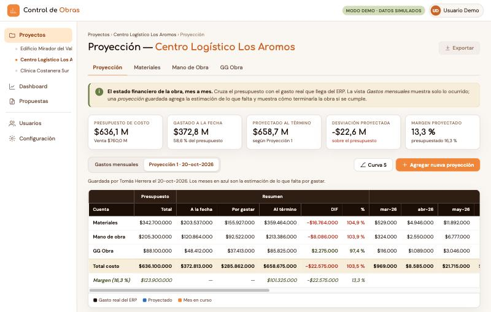
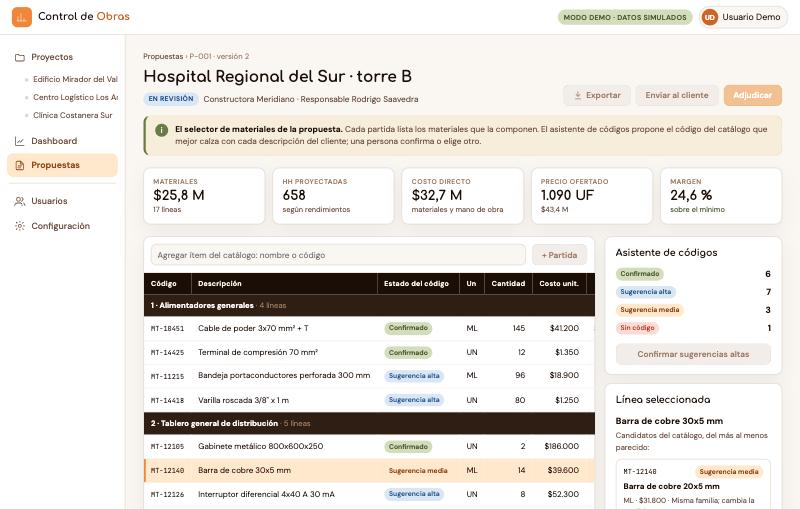

# Control de Obras · demo

**Demo en vivo / Live demo: [ardillalab.com/demo-obras](https://ardillalab.com/demo-obras/)**

[Español](#español) · [English](#english)



---

## Español

Demo navegable de un sistema de **planificación y control financiero de obras
eléctricas**. Muestra cómo una constructora sigue el gasto de cada obra contra su
presupuesto, mes a mes, y cómo arma sus propuestas a clientes.

Es una versión reducida de un aplicativo que está en producción. Aquí **todo es
simulado**: las obras, los clientes, los códigos y los montos. Las acciones que
modificarían datos (guardar, exportar, editar) están bloqueadas, y al pasar el
mouse cada una dice qué haría.

### Qué se puede recorrer

| Pantalla | Qué muestra |
|---|---|
| **Proyectos** | Las tres obras con su presupuesto, gasto y avance |
| **Proyección** | El estado financiero de una obra mes a mes, con gastos reales y una proyección guardada |
| **Materiales · Mano de Obra · GG Obra** | El detalle del gasto de cada obra, ordenado por partida |
| **Dashboard** | La mirada de gerencia sobre todas las obras, con gráfico y detalle |
| **Propuestas** | Las ofertas a clientes y el selector de materiales con su asistente de códigos |
| **Usuarios · Perfiles · Mi perfil** | Quién entra, con qué perfil y a qué obras |
| **Configuración** | Subcategorías y rendimientos de instalación |

### Cómo está hecha

- **Solo HTML y CSS.** No lleva ni una línea de JavaScript.
  - El aviso de «agenda una demo» usa el atributo nativo `popover`.
  - Los conmutadores y filtros usan radios con `:checked` y `:has()`.
  - Los gráficos son SVG generados de antemano.
- **Paleta de [ardillalab.com](https://ardillalab.com)**, con Comfortaa, DM Sans y
  JetBrains Mono.
- **Se adapta al celular**: el menú pasa a una barra horizontal y las tablas se
  desplazan dentro de su tarjeta.
- Las 22 páginas las arma un script en Python, sin dependencias externas
  (`generador/generar.py`), a partir de datos simulados deterministas
  (`generador/datos.py`). Lo que se publica es solo la carpeta `sitio/`.

### El aplicativo original

El sistema real corre en la nube y está construido con **Python y Django**,
**JavaScript**, **R** (los procesos de integración con el ERP), **PostgreSQL**,
**Docker** y **Google Cloud** (Cloud Run, Cloud SQL y Cloud Storage). Se alimenta
todos los días desde la API REST del ERP de la empresa.

### Estructura

```
generador/   datos simulados y script que arma las páginas
sitio/       lo que se publica: HTML y una hoja de estilos
docs/        capturas para este README
```

### Uso local

```bash
python3 generador/generar.py
```

```bash
python3 -m http.server 8000 --directory sitio
```

Después abre <http://localhost:8000>.

### Despliegue

Netlify publica la carpeta `sitio/` sin paso de build (ver `netlify.toml`).

### ¿Te interesa una solución así?

Agenda una conversación en
[Google Calendar](https://calendar.app.google/a8F5saYxdxWwMsWz7) o escribe por
[WhatsApp](https://wa.me/56985272032). Más en [ardillalab.com](https://ardillalab.com).

---

## English

A clickable demo of a **financial planning and cost-control system for
electrical construction projects**. It shows how a contractor tracks each
project's spending against its budget, month by month, and how it builds price
proposals for clients.

It is a trimmed-down version of an application that runs in production. Here
**everything is simulated**: projects, clients, item codes and amounts. Actions
that would change data (save, export, edit) are locked, and hovering over each
one tells you what it would do.



### What you can explore

| Screen | What it shows |
|---|---|
| **Projects** | Three projects with their budget, spending and progress |
| **Projection** | A project's monthly financial status, with actual spending and a saved forecast |
| **Materials · Labor · Site overhead** | Each project's spending, broken down by budget line |
| **Dashboard** | The management view across all projects, as a chart and a table |
| **Proposals** | Client offers, and the material selector with its code-matching assistant |
| **Users · Profiles · My profile** | Who signs in, with which profile and on which projects |
| **Settings** | Budget subcategories and installation productivity rates |

### How it is built

- **HTML and CSS only.** There is not a single line of JavaScript.
  - The "book a demo" dialog uses the native `popover` attribute.
  - Toggles and filters use radio inputs with `:checked` and `:has()`.
  - Charts are pre-rendered SVG.
- **[ardillalab.com](https://ardillalab.com) palette**, with Comfortaa, DM Sans
  and JetBrains Mono.
- **Mobile-friendly**: the side menu becomes a horizontal bar and tables scroll
  inside their cards.
- A dependency-free Python script (`generador/generar.py`) builds all 22 pages
  from deterministic mock data (`generador/datos.py`). Only the `sitio/` folder
  is published.

### The original application

The real system runs in the cloud and is built with **Python and Django**,
**JavaScript**, **R** (the ERP integration jobs), **PostgreSQL**, **Docker** and
**Google Cloud** (Cloud Run, Cloud SQL and Cloud Storage). It is fed daily from
the company ERP's REST API.

### Run it locally

```bash
python3 generador/generar.py
```

```bash
python3 -m http.server 8000 --directory sitio
```

Then open <http://localhost:8000>.

### Deployment

Netlify publishes the `sitio/` folder with no build step (see `netlify.toml`).

### Interested in a solution like this?

Book a call on [Google Calendar](https://calendar.app.google/a8F5saYxdxWwMsWz7)
or message me on [WhatsApp](https://wa.me/56985272032). More at
[ardillalab.com](https://ardillalab.com).

---

MIT License · © 2026 Ignacio Ardiles · [ardillalab.com](https://ardillalab.com)
